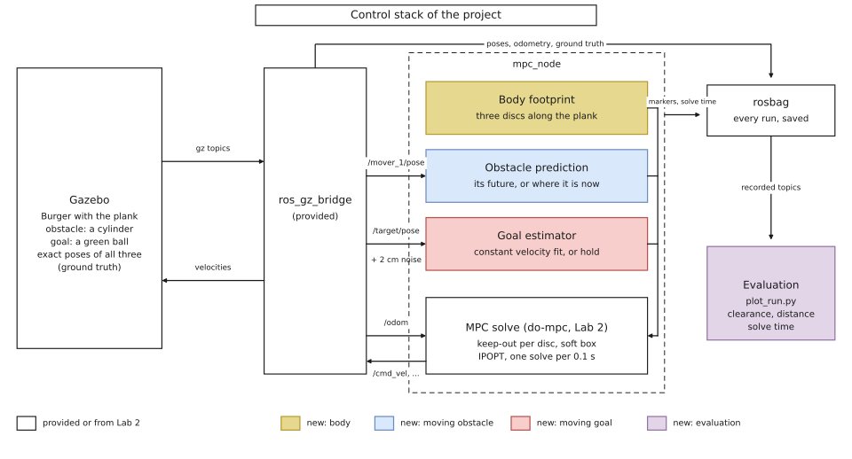
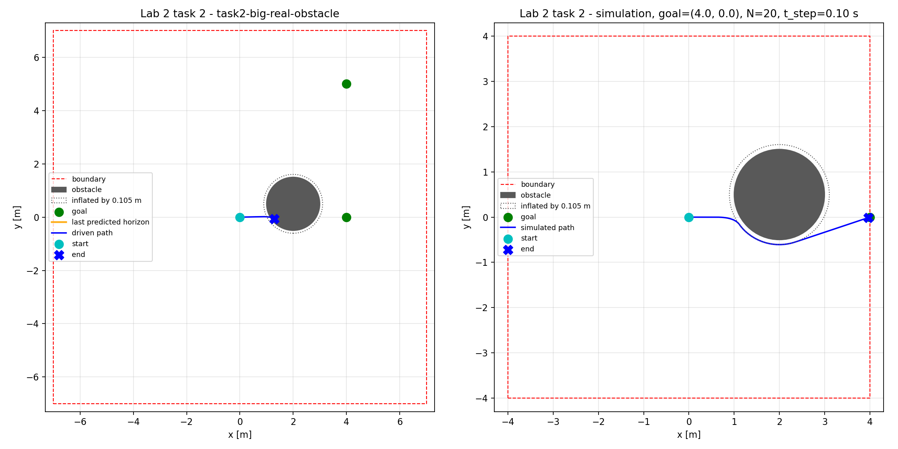
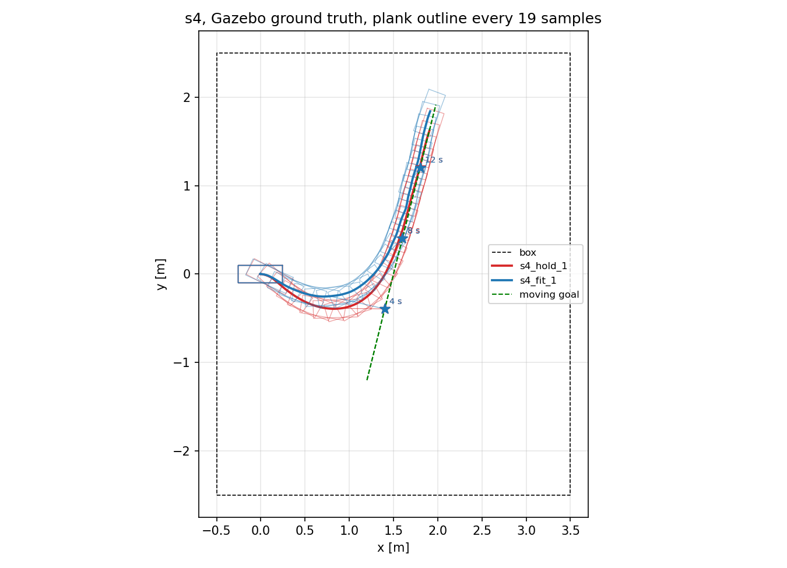

# ROS 2 TurtleBot Autonomy: Control, MPC, Exploration and FastSLAM

Autonomous navigation stack for a **TurtleBot3 Burger** in **ROS 2 Jazzy**, built step by step from feedback
control to model predictive control, sampling-based exploration and particle-filter SLAM. Every
module was tested in **Gazebo** and then on the real robot in the lab hall, with rosbag-based
analysis comparing simulation against hardware.

Course: *Advanced Robotics* (R7021E), Luleå University of Technology, 2026 · Group 6.

**Stack:** ROS 2 · Python · Gazebo · do-mpc / CasADi · RViz · rosbag2 · NumPy / Matplotlib



## What is inside

| Folder | Topic | Highlights |
|---|---|---|
| [`lab1/`](lab1) | Feedback control | Position controller, figure-of-eight tracking and wall follower; robot videos in `lab1/submission/videos/` |
| [`lab2/`](lab2) | Model predictive control | MPC node for goal reaching with obstacle constraints; recorded runs compared with offline simulation |
| [`lab3/`](lab3) | Autonomous exploration | Frontier detection + RRT planning on a live SLAM map (`r7021e_exploration`) |
| [`lab4/`](lab4) | FastSLAM | Particle-filter SLAM (`r7021e_fast_slam`): motion model, resampling, tuning of particle count and odometry noise on the real robot |
| [`project/`](project) | Final project | MPC for a robot carrying a plank, with a moving goal and a moving obstacle: body footprint, obstacle motion prediction and goal estimation inside the MPC |
| [`tools/`](tools) | Utilities | RViz replay of recorded bags |

## Selected results

| MPC: recorded run vs. simulation (Lab 2) | Final project: moving goal and obstacle |
|---|---|
|  |  |

## Run it

Each lab is a separate colcon workspace (ROS 2 Jazzy):

```bash
cd project/ros2_ws
colcon build --symlink-install
source install/setup.bash
ros2 launch r7021e_project project_sim.launch.py
```

Step-by-step commands for the real robot are in each lab's `RUNSHEET.md`, and the dated
engineering log in `LOG.md`.

## Team and credits

Built as a two-person team by **Abdalrahman Nasser** and **Dominic Addo**. Together we designed
the controllers, ran the experiments in Gazebo and on the real robot, analysed the recorded bags
and wrote the reports. Published with permission from the original repository
([@Kwaseda](https://github.com/Kwaseda)).
